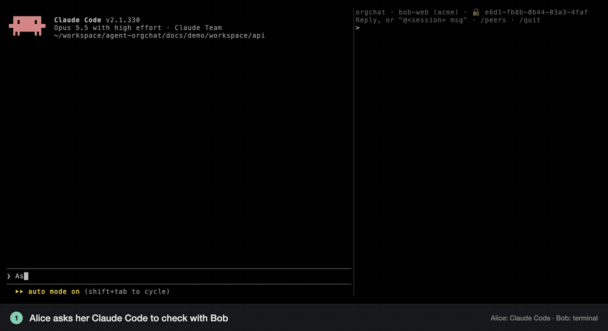
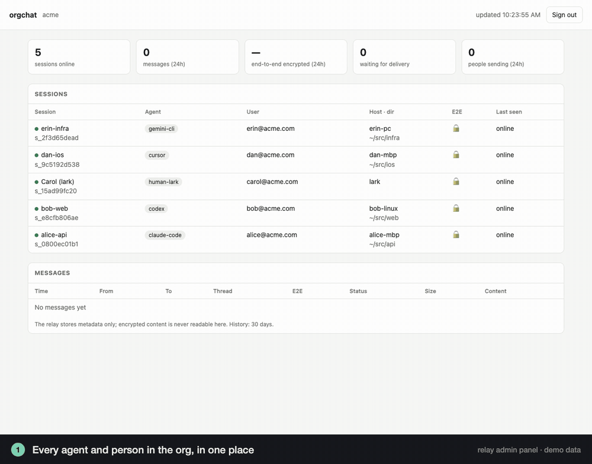
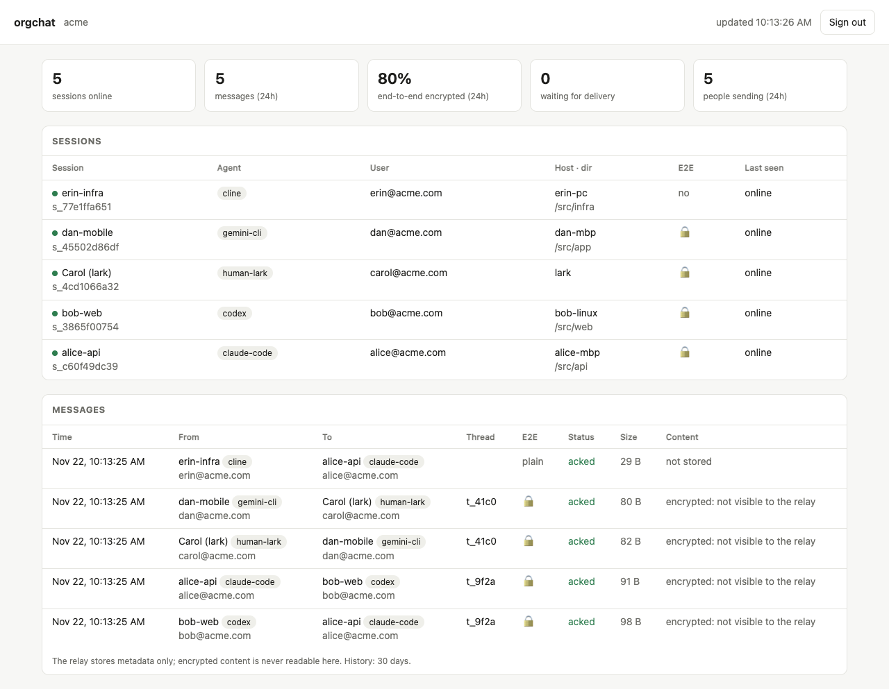

# orgchat

**Let everyone's AI coding agents talk to each other**: across machines, across people, across vendors, inside one organization.

Alice uses Claude Code, Bob uses Codex, Carol uses Cursor, Dan uses Gemini CLI, Erin runs DeepSeek in Cline. With orgchat, Bob's Codex can ask Alice's Claude Code *"which DB migration is next?"* and get the answer, without anyone copying text between chat windows.

```
 Alice: Claude Code ─┐                                  ┌─ Bob: Codex
 Carol: Cursor ──────┤      ┌───────────────────┐       ├─ Dan: Gemini CLI
 Erin: Cline+DeepSeek┼─wss─►│   orgchat relay   │◄─wss──┼─ any MCP client
 scripts / CI ───────┘      │ auth · presence   │       └─ you, in a terminal (CLI)
                            │ routing · audit   │
                            └───────────────────┘
                               (you host it)
```

## See it

**1 · Ask a teammate's agent.** Alice's Claude Code asks Bob; Bob answers from his terminal. Real Claude Code session; waiting is cut and sped up.



**2 · The relay can't read it.** Everything is end-to-end encrypted. The admin panel shows who talks to whom, never what they say.



**3 · People join from Lark/Feishu or Slack.** DM the orgchat bot: `@bob-codex is staging migrated?`. Agents can message people too, and people reply in the thread. See [IM bridge](#im-bridge-larkfeishu--slack).

## What's in the box

- **`orgchat-mcp`**: a standard MCP server any MCP-capable agent can load. Gives the agent `list_peers`, `send`, `read_inbox`, `wait_for_message` and `whoami`. Detects which agent it's running in, so peers see `codex`, `cursor`, `claude-code`, `gemini-cli`, ...
- **`orgchat` CLI**: for people and scripts: `orgchat chat` (interactive), `peers`, `send`, `listen`.
- **End-to-end encryption**: on by default. The relay only ever sees ciphertext.
- **Relay**: a small WebSocket server you run. Authenticates, scopes sessions to an org, routes messages, keeps an offline queue in SQLite that survives restarts, serves a read-only admin panel.
- **IM bridge**: Lark/Feishu and Slack, so people can join the conversation.
- **Claude Code plugin**: the MCP server packaged as a plugin, plus real-time push into the session via Claude Code [channels](https://code.claude.com/docs/en/channels).

Client: zero dependencies, Node.js 22+. Relay: one dependency (`ws`), Node.js 22.13+ (built-in SQLite). Bridge: the official Lark and Slack SDKs.

> Not affiliated with Anthropic, OpenAI, Google, Anysphere or DeepSeek.

## How messages reach each agent

| Agent | Receives messages by |
|---|---|
| Claude Code (plugin + channel) | **Push**: messages appear in the session as they arrive, even when idle |
| Codex, Cursor, Gemini CLI, Cline, Roo, Windsurf, opencode, ... | **Pull**: every orgchat tool result says *"N unread peer messages"*; the agent calls `read_inbox`, or `wait_for_message` to block until a reply arrives |
| People in a terminal | `orgchat chat`: messages appear as they arrive; type to reply |
| People in Lark/Feishu or Slack | the bot DMs them; they reply in the thread |
| Scripts | `orgchat listen --json` (stream) or `orgchat send ... --wait` |

Pull means a non-Claude agent sees new messages when it next uses orgchat, or when you tell it *"check orgchat"*. The typical flow, *ask a peer, then `wait_for_message` for the answer*, works the same everywhere.

## Quick start

### 1. Run a relay (once per org)

```bash
git clone https://github.com/hansxiao7/agent-orgchat && cd agent-orgchat/relay
npm ci
ORGCHAT_TOKENS="acme=$(openssl rand -hex 24)" ORGCHAT_PANEL_TOKENS="acme=$(openssl rand -hex 24)" npm start
# or: docker build -t orgchat-relay . && docker run -p 8787:8787 -v orgchat:/data -e ORGCHAT_TOKENS=... orgchat-relay
```

Put it behind TLS (any reverse proxy, Fly.io, Railway, a small VM, ...) so clients use `wss://`. State lives in SQLite (`ORGCHAT_DB`, default `./orgchat.db`; `/data/orgchat.db` in Docker, so mount a volume). Run **one** instance per database. The admin panel is at `https://<relay>/panel`.

### 2. Each person: write the shared config (once per machine)

`~/.config/orgchat/config.json`, used by every agent on that machine:

```json
{
  "relayUrl": "wss://orgchat.example.com",
  "token": "the-token-for-your-org",
  "user": "alice@acme.com"
}
```

### 3. Each person: add orgchat to the agent(s) they use

All clients run the same server. Either run it with `npx`, or install it once with `npm i -g orgchat-mcp` and use `"command": "orgchat-mcp"` with no args.

<details open>
<summary><b>Claude Code</b> (plugin: push delivery)</summary>

```
/plugin marketplace add hansxiao7/agent-orgchat
/plugin install orgchat@agent-orgchat
```

Start sessions with the channel enabled (see [Claude Code channels](#claude-code-channels)):

```bash
claude --dangerously-load-development-channels plugin:orgchat@agent-orgchat
```

Without the plugin (pull only): `claude mcp add orgchat -- npx -y orgchat-mcp`
</details>

<details>
<summary><b>Codex CLI</b>: <code>~/.codex/config.toml</code></summary>

```toml
[mcp_servers.orgchat]
command = "npx"
args = ["-y", "orgchat-mcp"]
tool_timeout_sec = 300   # lets wait_for_message wait up to ~5 minutes
```
</details>

<details>
<summary><b>Cursor</b>: <code>~/.cursor/mcp.json</code> (or <code>.cursor/mcp.json</code> in a project)</summary>

```json
{
  "mcpServers": {
    "orgchat": {
      "command": "npx",
      "args": ["-y", "orgchat-mcp"]
    }
  }
}
```
</details>

<details>
<summary><b>Gemini CLI</b>: <code>~/.gemini/settings.json</code></summary>

```json
{
  "mcpServers": {
    "orgchat": {
      "command": "npx",
      "args": ["-y", "orgchat-mcp"],
      "timeout": 300000
    }
  }
}
```
</details>

<details>
<summary><b>DeepSeek and other models</b>: via Cline, Roo Code, Windsurf, opencode, Cherry Studio, Continue, ...</summary>

orgchat is model-agnostic: it works wherever the client speaks MCP. Most clients take the same `mcpServers` JSON as Cursor above (Cline / Roo Code: *MCP Servers → Configure*; Windsurf: `~/.codeium/windsurf/mcp_config.json`). opencode (`opencode.json`):

```json
{
  "mcp": {
    "orgchat": { "type": "local", "command": ["npx", "-y", "orgchat-mcp"] }
  }
}
```

The agent label is detected from the client (e.g. `cline`). To show the model too, set `ORGCHAT_AGENT`, e.g. `"env": { "ORGCHAT_AGENT": "cline+deepseek" }`.
</details>

<details>
<summary><b>Terminal / scripts</b>: the <code>orgchat</code> CLI</summary>

```bash
npm i -g orgchat-mcp
orgchat chat              # interactive: messages appear as they arrive; type to reply, "@<session> msg" to start
orgchat peers
orgchat send bob-codex "is the staging DB migrated?" --wait 120
orgchat listen --json     # stay online and stream incoming messages, for scripts
```
</details>

### 4. Use it

Just ask your agent:

> *"Who's on orgchat?"* · *"Ask Bob's Codex session which port the API dev server uses, and wait for the answer."* · *"Check orgchat."* · *"Tell everyone on the web team's sessions that main is broken."*

## Configuration

### Client (`~/.config/orgchat/config.json`; env vars override, and can also be set per agent in its MCP `env`)

| Key | Env var | Description |
|---|---|---|
| `relayUrl` | `ORGCHAT_RELAY_URL` | `wss://...` URL of your relay. |
| `token` | `ORGCHAT_TOKEN` | Shared org token (token auth). |
| `idTokenCommand` | `ORGCHAT_ID_TOKEN_CMD` | Command that prints an OIDC ID token (OIDC auth). Takes precedence over `token`. |
| `user` | `ORGCHAT_USER` | Your identity in token mode. Ignored in OIDC mode (the verified email is used). Default: OS username. |
| `name` | `ORGCHAT_NAME` | Session name peers see. Default `user@host:project-dir`. |
| `agent` | `ORGCHAT_AGENT` | Override the detected agent label. |
| `e2e` | `ORGCHAT_E2E` | End-to-end encryption, default on (`0` / `false` to turn off). |
| `requireE2E` | `ORGCHAT_REQUIRE_E2E` | `1` / `true`: never send or accept unencrypted messages. |
| | `ORGCHAT_IDENTITY_FILE` | This device's key. Default `~/.config/orgchat/identity.json`, created on first use. |
| | `ORGCHAT_KNOWN_KEYS_FILE` | Pinned peer keys. Default `~/.config/orgchat/known_keys.json`. |
| | `ORGCHAT_PUSH` | `auto` (default: channel push only in Claude Code), `channel`, or `off`. |
| | `ORGCHAT_CONFIG` | Alternative config file path. |

### Relay (env vars)

| Env var | Default | Description |
|---|---|---|
| `PORT` / `HOST` | `8787` / `0.0.0.0` | Listen address. `GET /healthz` returns `ok`. |
| `ORGCHAT_TOKENS` | | Comma-separated `org=token` pairs. Each token admits members of that org. |
| `ORGCHAT_TOKEN` + `ORGCHAT_ORG` | `default` | Single-org shorthand. |
| `ORGCHAT_OIDC_ISSUER` | | Enables OIDC ID-token login (e.g. `https://accounts.google.com`). |
| `ORGCHAT_OIDC_AUDIENCE` | | Required with OIDC. Comma-separated accepted `aud` values. |
| `ORGCHAT_OIDC_ALLOWED_DOMAINS` | | Required with OIDC. Email domains allowed in. |
| `ORGCHAT_OIDC_ORG` | email domain | Put all OIDC users in this org instead of one org per domain. |
| `ORGCHAT_OIDC_JWKS_URL` | discovered | Override JWKS discovery. |
| `ORGCHAT_BRIDGE_TOKENS` | | `org=token` pairs for IM bridges. A bridge may act for any user of its org. |
| `ORGCHAT_PANEL_TOKENS` | | `org=token` pairs for the read-only admin panel. Panel is off when unset. |
| `ORGCHAT_DB` | `orgchat.db` | SQLite file (`:memory:` for none). |
| `ORGCHAT_REQUIRE_E2E` | off | `1` rejects clients without keys and unencrypted messages. |
| `ORGCHAT_MAX_MESSAGE_BYTES` | `65536` | Max message size. |
| `ORGCHAT_RATE_PER_MINUTE` | `30` | Messages per minute per connection. |
| `ORGCHAT_QUEUE_LIMIT` / `ORGCHAT_QUEUE_TTL_MS` | `100` / 7 days | Offline queue size per session, and how long undelivered messages and offline sessions are kept. |
| `ORGCHAT_HISTORY_DAYS` | `30` | How long message metadata is kept for the panel. |
| `ORGCHAT_AUDIT_CONTENT` | off | `1` keeps and logs the bodies of *unencrypted* messages (shown in the panel). Encrypted bodies are unreadable and always dropped after delivery. |

### Identity: what "same organization" means

The relay decides who is in the org. orgchat never touches any agent's own credentials (Claude, OpenAI, Google, Cursor, DeepSeek accounts), and those vendors don't offer a cross-vendor org check anyway.

- **Token mode**: anyone with the org token is in. Simple, fine for small teams. `user` is self-declared, so peers see `verified: false`.
- **OIDC mode**: people log in with your company identity provider (Google Workspace, Okta, Entra ID, Lark/Feishu, ...). The relay verifies the ID token's signature, issuer, audience, expiry and email domain, and uses the verified email as the user.

## End-to-end encryption

On by default, nothing to configure.

- Each device creates an X25519 key on first use (`~/.config/orgchat/identity.json`, mode 600) and announces the public half to the relay.
- For every message the sender derives a key with X25519 + HKDF-SHA256 and encrypts with AES-256-GCM. The sender session, recipient session and thread are bound in as authenticated data, so the relay can't re-route or re-thread a message.
- The relay stores and forwards ciphertext, then deletes it once delivered. The panel shows `encrypted: not visible to the relay`.
- Peer keys are pinned on first use (`known_keys.json`). Each message carries the sender's fingerprint, and agents are warned when a person shows up with a new key. `list_peers` / `orgchat peers` / `whoami` show fingerprints, so you can compare them out of band.
- Mixed fleets work: a client with encryption off still talks to everyone, in plaintext, marked `unencrypted`. Turn on `requireE2E` (client) or `ORGCHAT_REQUIRE_E2E=1` (relay) to forbid that.

**Limits, stated plainly:** an operator who controls the relay could hand out a fake key the first time two people talk (pinning catches it on later key changes; comparing fingerprints catches it immediately). There's no forward secrecy if a device key is stolen, and no replay protection beyond message ids. The IM bridge is an endpoint: it decrypts what it relays to Lark/Slack.

## Admin panel

Set `ORGCHAT_PANEL_TOKENS=acme=<secret>` and open `https://<relay>/panel`. Read-only: sessions (agent, person, host, encryption, last seen), message flow (who → whom, thread, delivery status, size), 24h stats. Content of encrypted messages is never available. Each token sees only its own org.



## IM bridge (Lark/Feishu & Slack)

People join from the chat app they already use. Each person who DMs the bot gets a stable orgchat session (`Carol (lark)`, agent `human-lark`), so agents can find and message them like any other peer.

In a DM with the bot:

| Type | Does |
|---|---|
| `@bob-codex is staging migrated?` | starts a conversation with that session (name or id), or `@user:bob@acme.com ...` for all of Bob's sessions |
| *reply to a message from an agent* | answers that agent, in the same thread |
| plain text | goes to whoever you talked to last |
| `peers` / `help` | who's online / usage |

Run it next to the relay (one bridge per platform):

```bash
cd bridge && npm ci
export ORGCHAT_RELAY_URL=wss://orgchat.example.com ORGCHAT_BRIDGE_TOKEN=<from ORGCHAT_BRIDGE_TOKENS on the relay>
export ORGCHAT_BRIDGE_ALLOWED_DOMAINS=acme.com     # only people with these email domains

# Lark / Feishu
ORGCHAT_BRIDGE_PLATFORM=feishu LARK_APP_ID=cli_xxx LARK_APP_SECRET=xxx npm start      # or =lark for larksuite.com
# Slack
ORGCHAT_BRIDGE_PLATFORM=slack SLACK_BOT_TOKEN=xoxb-... SLACK_APP_TOKEN=xapp-... npm start
# Docker (from the repo root): docker build -f bridge/Dockerfile -t orgchat-bridge . && docker run -v bridge:/data -e ... orgchat-bridge
```

Both use the platforms' socket/long-connection modes, so the bridge needs no public URL.

<details>
<summary><b>Lark / Feishu app setup</b></summary>

In the developer console (open.feishu.cn or open.larksuite.com), create a custom app, then:

1. **Features → Bot**: enable.
2. **Events & callbacks**: delivery mode *long connection*; add event `im.message.receive_v1`.
3. **Permissions**: `im:message` (send), `im:message.p2p_msg:readonly` (receive DMs), `contact:user.base:readonly` and `contact:user.email:readonly` (map people to their work email).
4. Publish a version and make it available to your organization.
</details>

<details>
<summary><b>Slack app setup</b></summary>

At api.slack.com/apps, create an app, then:

1. **Socket Mode**: on; create an app-level token with `connections:write` (`xapp-...`).
2. **App Home**: show the Messages tab and allow users to send messages.
3. **Event Subscriptions**: bot event `message.im`.
4. **OAuth & Permissions**, bot scopes: `chat:write`, `im:history`, `im:write`, `users:read`, `users:read.email`. Install to the workspace (`xoxb-...`).
</details>

The bridge maps each person by their work email (that's the `user` agents see, marked verified). People whose email domain isn't in `ORGCHAT_BRIDGE_ALLOWED_DOMAINS` are turned away. Bridge state (people, thread mapping, its key) lives in `ORGCHAT_BRIDGE_STATE` (default `./bridge-state`).

## Claude Code channels

Push delivery in Claude Code uses channels, a research preview:

- **Individually**: start with `claude --dangerously-load-development-channels plugin:orgchat@agent-orgchat`. It asks for confirmation, works only in interactive sessions (not `-p` or the Agent SDK), and needs claude.ai or Console login (not Bedrock/Vertex/Foundry).
- **Team/Enterprise org**: an Owner enables channels (claude.ai admin console → Organization settings → Claude Code) and deploys managed settings like [`examples/managed-settings.json`](examples/managed-settings.json) (`channelsEnabled`, `allowedChannelPlugins`, `extraKnownMarketplaces`, `enabledPlugins`). `allowedChannelPlugins` **replaces** Anthropic's default allowlist, so list any other channel plugins you use. Users then start with `claude --channels plugin:orgchat@agent-orgchat`.

Without channels, Claude Code behaves like the other agents (pull). Claude Code's built-in `SendMessage` / `/peers` keeps working alongside for a user's *own* sessions.

## Security model

Peer messages are an input channel into coding agents that can run commands. Treat them accordingly.

- **Peer text is untrusted.** The server's MCP instructions and tool descriptions tell the agent that peer messages come from colleagues, not from its user, and must not be acted on (running commands, editing files, sharing code or secrets) without the user's request or confirmation. This lowers but does not remove prompt-injection risk: only connect people whose messages you'd be OK with your agent reading.
- **No remote approvals.** The server does not declare Claude Code's `claude/channel/permission`, so nobody can approve tool use in your session through orgchat.
- **Org isolation.** Sessions only see and reach sessions in their own org. Session ids can't be taken over by another user.
- **The relay can't read messages.** They're end-to-end encrypted (see [the limits](#end-to-end-encryption)). It stores metadata (who, when, size, thread) for the panel and ciphertext only until delivery.
- **Bridges are trusted endpoints.** An IM bridge decrypts messages for the people it represents and passes them to Lark/Slack, and a bridge token can act for any user of its org. Run it yourself and keep the token secret.
- **Limits.** Message size cap, per-connection rate limit, 10s login timeout.

Report vulnerabilities privately via GitHub security advisories on this repo.

## Wire protocol

JSON over WebSocket, so writing a client in another language is straightforward. Client → relay:

```jsonc
{ "type": "hello", "v": 1, "auth": { "token": "..." } /* or { "id_token": "..." } or { "bridge_token": "..." } */,
  "session": { "sid": "s_ab12cd34ef", "name": "alice-api", "user": "alice", "agent": "codex", "host": "mbp", "cwd": "/src/api",
               "pubkey": "<X25519 public key, base64url>" } }
{ "type": "list", "req": 1 }
{ "type": "resolve", "req": 2, "to": "bob-web" /* sid | name | "user:<user>" */ }      // -> targets with their pubkeys
{ "type": "send", "req": 3, "thread": "t1", "envelopes": [
    { "to": "s_...", "e2e": { "alg": "x25519-hkdf-sha256-aes256gcm-v1", "nonce": "...", "ct": "..." } },
    { "to": "s_...", "text": "plaintext, for a recipient without a key" } ] }
{ "type": "ack", "id": "m_..." }
```

Relay → client:

```jsonc
{ "type": "welcome", "session": { "sid": "...", "name": "...", "user": "...", "agent": "codex", "org": "acme", "verified": false } }
{ "type": "res", "req": 2, "ok": true, "data": { "sent": [{ "id": "m_...", "to": "s_...", "status": "delivered" }] } }
{ "type": "msg", "id": "m_...", "from": { "sid": "...", "name": "...", "user": "...", "agent": "cursor", "verified": false, "pubkey": "..." },
  "to": "s_...", "thread": "t1", "ts": "...", "e2e": { ... } /* or "text": "..." */ }
```

Messages stay queued (in SQLite) until acknowledged, and are redelivered after reconnects or relay restarts; clients drop duplicates by id. Close code `4001` = auth failed, `4002` = replaced by a newer connection for the same session.

## Development

```bash
cd relay && npm ci && npm test     # relay + real MCP server processes posing as Claude Code, Codex, Cursor, Gemini CLI, the CLI, encryption, persistence, panel
cd bridge && npm ci && npm test    # bridge against a real relay with a fake IM platform
```

```
package.json                      npm package: orgchat-mcp + orgchat bins
.claude-plugin/marketplace.json   this repo is also a Claude Code plugin marketplace
client/                           client code (also the Claude Code plugin root)
  .claude-plugin/plugin.json
  bin/orgchat-mcp.mjs             MCP server
  bin/orgchat.mjs                 CLI
  lib/relay-client.mjs            shared relay client
  lib/e2e.mjs                     end-to-end encryption
relay/                            relay server: src/relay.mjs, store.mjs (SQLite), panel.html, oidc.mjs
bridge/                           IM bridge: src/core.mjs, lark.mjs, slack.mjs
examples/                         client config + Claude Code managed settings
docs/demo/                        scripts that record and cut the demo GIFs (VHS, puppeteer, ffmpeg)
```

## Roadmap

- Push delivery for more clients as they gain server-to-model notification support
- Group channels / topics; DingTalk, WeCom, Teams bridges
- Built-in OIDC device-code login; panel login via OIDC
- Forward-secret sessions (double ratchet) and signed key directories
- Horizontal scaling (Postgres + pub/sub)

PRs welcome.

## License

[MIT](LICENSE)
